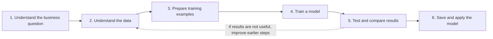

# Beginner Guide: How This Project Turns Data into a Model

This is the plain-language companion to [`notebooks/03_Dataset_to_Model_70_30.ipynb`](../notebooks/03_Dataset_to_Model_70_30.ipynb). Read the sections in order, then run the notebook one cell at a time. You do not need to understand every line of Python on your first pass.

## The whole idea, first

Imagine a shop wants to know how many cans of soup it may sell each day next month. We show a computer examples from the past: what the product was, which shop sold it, the date, its price, and what it sold recently. The computer learns relationships between those inputs and the number of units sold.

After learning, we give the computer recent information for a product-store pair and ask it to estimate sales for future days. Those estimates can help a person plan stock. They are not guaranteed answers, and this project does not place orders automatically.

In this project the computer model is LightGBM, a machine-learning program that learns many small decision trees. This is a forecasting model, not a chatbot.

## The six CRISP-DM steps

CRISP-DM is a common way to organize a data science project. It stands for Cross-Industry Standard Process for Data Mining. It reminds us that a model is only one part of the work.



| Step | In everyday words | What we did here | How complete? |
| --- | --- | --- | --- |
| 1. Business understanding | Decide what problem matters and what a useful answer means. | Framed the research as predicting daily product-store sales and reducing forecast error versus simple rules. | Partial. No retailer or business stakeholder supplied a cost target, inventory policy, or acceptance threshold. |
| 2. Data understanding | Learn what information is available and whether it looks usable. | Inspected the M5 sales, calendar, and scheduled-price data. The working validation file has 30,490 product-store rows and 1,913 daily columns. | Done for this dataset and experiment. |
| 3. Data preparation | Turn the original files into clean examples the model can learn from. | Matched dates, calendar values, prices, and product/store identifiers; made history features; split dates into 70% training and 30% test. | Done for the research workflow. |
| 4. Modeling | Teach an algorithm using examples from the training part. | Selected LightGBM's tree count using a validation slice inside the 70%, then refit using the eligible training dates. | Done. |
| 5. Evaluation | Give the model unseen examples and measure its mistakes. | Forecast the last 30% of dates in rolling windows; compared against two simple baselines and calculated error scores. | Done on this historical holdout. |
| 6. Deployment | Make the trained model available to the people or software that will use it. | Saved a model bundle, demonstrated one prediction, and built a local API. | Prototype only. It is not hosted for a retailer and has no ongoing monitoring or retraining process. |

### So, did we follow all of CRISP-DM?

We used all six CRISP-DM phases to organize the project, and we implemented research work in each phase. We have **not completed the whole real-world lifecycle**: the business goal has not been checked with a retailer, and deployment is only a local prototype. In particular, nobody has set a business cost for being short or overstocked, accepted a target level of forecast error, connected this model to live store systems, or monitored it after launch.

CRISP-DM is a loop. If the model is not useful, the team should revisit the business question, inspect the data, improve features, or try another model. A low error score by itself does not prove that a retailer will save money.

## What data goes in?

The project uses the M5 retail forecasting data. Download the files from the [M5 Forecasting Accuracy data page](https://www.kaggle.com/competitions/m5-forecasting-accuracy/data) and place the required files here:

```text
data/raw/
├── sales_train_validation.csv
├── calendar.csv
└── sell_prices.csv
```

- **Sales file:** each row is a product sold at one store. Columns `d_1`, `d_2`, etc. are the amount sold on successive days.
- **Calendar file:** tells us which date each `d_...` identifier means, the weekday, events, and other calendar facts.
- **Price file:** gives the scheduled price for a product at a store in a retail week.

These source files are intentionally not stored in Git because they are large. The training notebook needs the three files above. The separate older exploration notebook also reads `sales_train_evaluation.csv` and `sample_submission.csv`.

## What does “70% train and 30% test” mean?

The data is time-based, so we sort by date and use the early dates to teach the model. The later dates are held back as a final exam. In this dataset, there are 1,913 daily observations per series: the first 1,339 days are the training period, and the final 574 days are the test period.

We do **not** randomly mix days. If a model learned from December and was tested on October, it would have seen the future. That would make the score look better than a real forecast could be.

There is also a smaller validation slice inside the first 70%. It helps choose the number of trees. Think of it as practice questions used to decide when to stop studying. The 30% test period is the final exam; it is not used to choose the model.

## How does a row become a model example?

For one product in one store on one target day, we make input clues (called **features**) such as:

- how many units sold yesterday, one week ago, two weeks ago, and four weeks ago;
- average sales and how often sales were zero in recent weeks;
- weekday, month, weekend, event, and SNAP program flags;
- the product's store, category, department, and state;
- scheduled price and recent price changes.

The answer column (called the **target** or **label**) is the number of units actually sold on that target day. The algorithm sees many examples of clues and answers and learns patterns. The first 28 days are used as history to make lag features, so they are not target examples in the final fit.

The model predicts one day at a time. For the next day, its own previous prediction is added to the recent history. This is called a recursive forecast. It lets us forecast up to 28 days even though we only predict one day in each step.

## How do we know if the model helped?

We compare it with two easy-to-understand rules:

1. **Same weekday last week:** predict Monday from last Monday, Tuesday from last Tuesday, and so on.
2. **Recent weekday average:** average the last four Mondays to predict Monday, and similarly for other weekdays.

Then we compare the model's forecasts with the real held-out sales:

- **WAPE** compares total absolute mistakes with total units sold. Lower is better. For example, WAPE `0.72` means total absolute error is about 72% of total actual demand. It does not mean 72% of predictions are wrong.
- **MAE** is the average size of the error in units. If MAE is `0.9`, a prediction differs from the actual by about 0.9 units on average.
- **RMSE** is another error measure that gives bigger mistakes extra weight. Lower is better.
- **Bootstrap interval** resamples product-store series to estimate how much the aggregate improvement might vary. It is uncertainty about the comparison, not a guaranteed range for an individual forecast.

In the completed full-population holdout run already recorded locally, the model's WAPE was about `0.717`, the four-week weekday baseline was about `0.833`, and the same-weekday baseline was about `0.938`. That means the model had lower aggregate error on this historical test window. The result applies to this dataset and setup; it is not a promise of the same result for another company. Re-running may produce slightly different metadata timestamps, but the seeded experiment and package versions are recorded to support reproducibility.

## What does the model result look like on disk?

After the notebook finishes, look in:

```text
artifacts/holdout_70_30/
```

| File | Plain-language meaning |
| --- | --- |
| `lightgbm_price.txt` | The trained model: the learned decision trees. This is the key file used to make predictions. |
| `model_metadata.json` | Notes the model needs, such as feature names and how product/store categories were encoded. |
| `metrics.csv` | Scorecard for the model and both baselines. |
| `bootstrap_comparison.csv` | Estimated improvement and uncertainty range for comparisons with the baselines. |
| `series_metrics.csv` | A more detailed error record for each product-store series. |
| `run_manifest.json` | Audit note with train/test dates, data checksums, and software versions. |

These files are generated locally and ignored by Git. They are created by running the notebook; they do not appear in a fresh clone until you run it with the data files present.

## How is the model used?

The saved model is loaded by `src/forecast_inference.py`. A calling program gives it:

1. which product and store to forecast;
2. that series' latest 28 daily sales;
3. the latest and upcoming scheduled prices;
4. calendar and event information for the next 28 days.

It returns one estimated unit count for each of the next 28 days. `src/api.py` makes this prediction helper available as a local web service. Start it from the project root after training:

```powershell
$env:FORECAST_MODEL_DIR = 'artifacts/holdout_70_30'
python -m uvicorn src.api:app --host 127.0.0.1 --port 8000
```

Open `http://127.0.0.1:8000/docs` to see the request form. This is a demo on your own computer. A live retail application would need trustworthy current data, a secure hosted service, business rules, staff review, monitoring for changing sales patterns, and an agreed schedule for retraining. The API does not decide how much to order.

## Run the CRISP-DM notebook

1. Set up Python and the project packages using [`PROJECT_GUIDE.md`](PROJECT_GUIDE.md#4-set-up-python).
2. Put the three required CSV files under `data/raw/`.
3. Open the repository root in Jupyter and open [`03_Dataset_to_Model_70_30.ipynb`](../notebooks/03_Dataset_to_Model_70_30.ipynb).
4. Run the notebook cells from the top, in order. For a first try, set `MAX_SERIES = 1000` and `BOOTSTRAP_REPLICATES = 50`. For the full dataset, use `MAX_SERIES = 0` and `BOOTSTRAP_REPLICATES = 1000`.

The notebook prints progress and score tables, saves the model and reports, then reloads the saved model for a small example forecast. Full-population training can use substantial memory and take a while.
